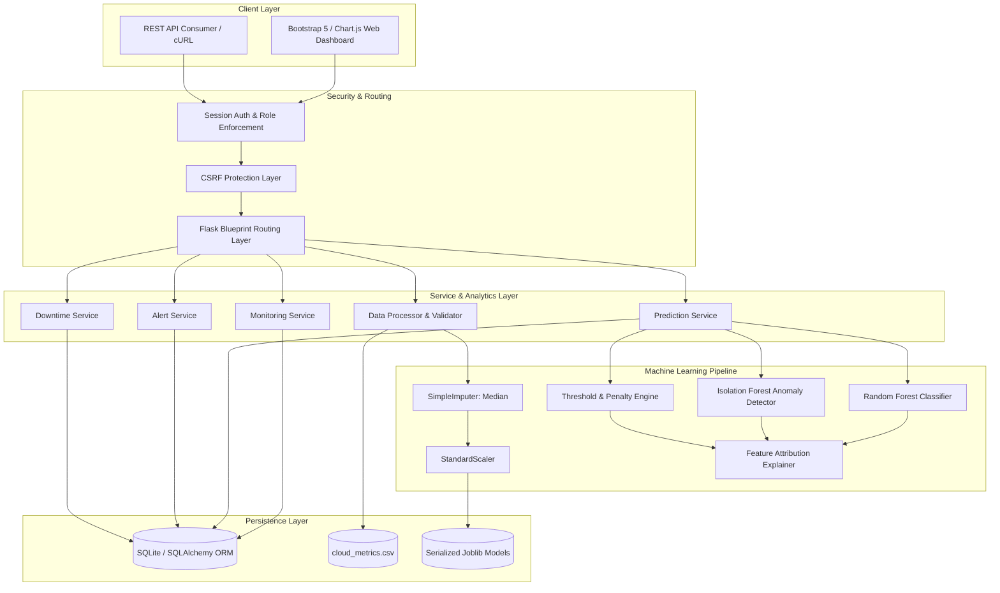

# CloudPulse: Predictive Cloud Service Failure and Downtime Analyzer

[](https://www.python.org/downloads/)
[](https://flask.palletsprojects.com/)
[](https://scikit-learn.org/)
[](https://opensource.org/licenses/MIT)
[]()

> **An intelligent, full-stack cloud infrastructure reliability monitoring and failure prediction system combining supervised machine learning (Random Forest), unsupervised multivariate anomaly detection (Isolation Forest), rule-based risk scoring, and downtime analytics.**

---

## Table of Contents
1. [Project Abstract](#1-project-abstract)
2. [Problem Statement](#2-problem-statement)
3. [Project Objectives](#3-project-objectives)
4. [Existing System vs. Proposed System](#4-existing-system-vs-proposed-system)
5. [System Architecture](#5-system-architecture)
6. [Module Descriptions](#6-module-descriptions)
7. [Technology Stack](#7-technology-stack)
8. [Dataset Description & Synthesis](#8-dataset-description--synthesis)
9. [Machine Learning Methodology](#9-machine-learning-methodology)
10. [Database Schema & ER Model](#10-database-schema--er-model)
11. [Installation & Setup Guide](#11-installation--setup-guide)
12. [Execution Instructions](#12-execution-instructions)
13. [Automated Testing](#13-automated-testing)
14. [REST API Documentation](#14-rest-api-documentation)
15. [User Interface & Dashboard Showcase](#15-user-interface--dashboard-showcase)
16. [Limitations & Future Enhancements](#16-limitations--future-enhancements)
17. [Deployment Guide](#17-deployment-guide)
18. [GitHub Repository Push Instructions](#18-github-repository-push-instructions)

---

## 1. Project Abstract
Modern distributed enterprise cloud computing infrastructures generate voluminous streams of telemetry data across multiple compute nodes, API gateways, database clusters, and microservices. Unanticipated service degradations and catastrophic server failures lead to severe financial penalties and service-level agreement (SLA) breaches. Traditional threshold-based monitoring systems typically react only **after** outages occur.

**CloudPulse** is an end-to-end, full-stack predictive cloud failure and downtime analyzer. Built with Python Flask, SQLAlchemy, scikit-learn, Bootstrap 5, and Chart.js, CloudPulse ingests multivariate telemetry streams (CPU, memory, latency, request velocity, error rates, disk I/O, response times) and combines a **Random Forest Classifier** with an **Isolation Forest Anomaly Detector** and a **rule-based multi-metric threshold engine**. The hybrid scoring module produces an interpretable Failure-Risk Score (0–100), classifies service health into four tiers (*Healthy*, *Warning*, *High Risk*, *Critical*), delivers root-cause diagnostic explanations with feature attribution, and generates preventive operator recommendations before downtime occurs.

---

## 2. Problem Statement
Distributed cloud platforms encounter dynamic workloads, sudden resource saturation, memory leaks, and network congestion. Existing infrastructure monitoring tools suffer from several critical shortcomings:
1. **Reactive Post-Mortem Alerting**: Conventional alerts trigger only after an error rate surges or an instance crashes, leaving DevOps teams with zero lead time for preventive mitigation.
2. **Alert Fatigue & Noise**: Static single-metric thresholds (e.g. CPU > 80%) generate excessive false positives during benign batch processing, obscuring genuine multi-metric distress signals.
3. **Black-Box Opacity**: Naive machine learning models fail to explain **why** a service was flagged as high-risk, inhibiting rapid remediation.
4. **Disjointed Outage Analytics**: Outage tracking, MTBF (Mean Time Between Failures), MTTR (Mean Time To Recovery), and SLA availability computations are often siloed away from predictive monitoring.

---

## 3. Project Objectives
- **Continuous Telemetry Processing**: Ingest and process telemetry metrics across microservices, databases, and gateways.
- **Hybrid Machine Learning Failure Prediction**: Combine supervised learning (Random Forest for known failure signatures) with unsupervised learning (Isolation Forest for zero-day outliers).
- **Interpretable Diagnostic Attribution**: Deliver transparent explanations highlighting exact metric overshoot percentages and feature contributions.
- **Proactive Risk Scoring & Alerting**: Compute a calibrated composite risk score (0 to 100) and dispatch severity-ranked predictive alerts.
- **Comprehensive Downtime Analytics**: Formally calculate service availability percentages across explicit observation windows (7d, 30d, 60d) and rank frequently affected services.
- **Enterprise-Grade Web Console**: Provide an interactive dark-navy dashboard with live Chart.js visualizations, role-based access control (Admin/Analyst), CSV ingestion with strict schema validation, and printable executive audit reports.

---

## 4. Existing System vs. Proposed System

| Dimension | Existing Monitoring Systems | CloudPulse Proposed System |
| :--- | :--- | :--- |
| **Detection Paradigm** | Reactive (post-incident alerts) | Predictive (pre-failure early warning) |
| **Modeling Approach** | Rigid single-metric thresholds | Hybrid: Supervised RF + Unsupervised Isolation Forest + Thresholds |
| **Telemetry Analysis** | Isolated metrics evaluated independently | Multivariate correlation across CPU, RAM, Disk, Latency, and Error Rate |
| **Explainability** | Opaque trigger alerts | Transparent diagnostic explanations & metric overshoot attribution |
| **Outage Analytics** | Disjointed or manual log parsing | Automated MTBF, MTTR, and SLA availability calculation |
| **Dataset Ingestion** | Fixed proprietary agent formats | Flexible CSV ingestion with real-time range & type validation |
| **Safety Posture** | Risky automated mutations | Advisory recommendations requiring administrator verification |

---

## 5. System Architecture



---

## 6. Module Descriptions

### 6.1 Data Processing & Ingestion (`services/data_processor.py`)
- Validates CSV telemetry datasets against strict schema and range boundaries (CPU: 0–100%, Error Rate: 0–100%, Latency ≥ 0ms).
- Rejects malformed rows with line-by-line diagnostic error reports.
- Generates reproducible, realistic synthetic telemetry data (`cloud_metrics.csv`) containing 1,500+ records across 6 cloud service tiers.

### 6.2 Monitoring Service (`services/monitoring_service.py`)
- Aggregates fleet-wide infrastructure telemetry (average CPU, memory, latency, and request velocity).
- Seeds initial demonstration services, historical metrics, and past outage records.
- Provides real-time snapshot queries for active compute instances.

### 6.3 Machine Learning Failure Predictor (`models/failure_predictor.py`)
- **Random Forest Classifier**: Supervised classification trained on labeled historical records with class balancing.
- **Isolation Forest**: Unsupervised anomaly detection on scaled multivariate features to catch zero-day degradation patterns.
- **Hybrid Risk Scoring**: Synthesizes supervised probabilities, anomaly scores, and saturation penalties into a 0–100 risk score.
- **Status Tiers**: *Healthy* (0–29), *Warning* (30–59), *High Risk* (60–79), *Critical* (80–100).
- **Attribution Explainer**: Extracts metric overshoot percentages and features that deviated significantly from healthy baselines.

### 6.4 Alert Service (`services/alert_service.py`)
- Dispatches severity-ranked alerts (*Low*, *Medium*, *High*, *Critical*) upon threshold violations or ML anomalies.
- Deduplicates repetitive active alerts to prevent alert storms.
- Provides operator acknowledgment and resolution workflows with mandatory mitigation note recording.

### 6.5 Downtime Analytics Service (`services/downtime_service.py`)
- Records simulated outage events with root cause and duration tracking.
- Calculates mathematically rigorous availability percentages across explicit observation windows:
  $$\text{Availability \%} = \frac{\text{Window Minutes} - \text{Total Downtime Minutes}}{\text{Window Minutes}} \times 100\%$$
- Computes Mean Time To Recovery (MTTR) and Mean Time Between Failures (MTBF).

### 6.6 Security & Authentication (`routes/auth.py`)
- Secure password hashing with `werkzeug.security`.
- Role-Based Access Control (RBAC): `admin` (full configuration and retraining permissions) vs. `analyst` (read-only and alert triage).
- CSRF token validation and protected API decorators.

---

## 7. Technology Stack

- **Backend**: Python 3.12, Flask 3.1, Werkzeug
- **Database & ORM**: SQLite 3, SQLAlchemy 2.1, Flask-SQLAlchemy 3.1
- **Machine Learning & Data**: scikit-learn 1.9, pandas 3.1, NumPy 2.5, joblib 1.6
- **Testing Framework**: pytest 9.1
- **Frontend Architecture**: HTML5, Vanilla CSS3 (Custom Dark Navy Design System), JavaScript (ES6+)
- **Styling & Components**: Bootstrap 5.3, Bootstrap Icons 1.11, Google Fonts (Inter & Outfit)
- **Data Visualization**: Chart.js 4.4 (Multi-line area charts, dual-axis latency charts, doughnut risk charts, health status bar charts)
- **Deployment Targets**: Render, Railway, PythonAnywhere, Docker, or AWS Elastic Beanstalk

---

## 8. Dataset Description & Synthesis

The demonstration dataset `dataset/cloud_metrics.csv` contains **1,500 continuous telemetry records** sampled at 5-minute intervals across 6 simulated enterprise cloud services:
1. `api-gateway-us-east` (Edge API Gateway)
2. `auth-service-us-east` (Authentication Microservice)
3. `payment-service-prod` (Mission-Critical Payment Worker)
4. `user-db-cluster-primary` (Primary Relational Database)
5. `inventory-service-v2` (Catalog Microservice)
6. `notification-worker-pool` (Asynchronous Message Queue Worker)

### Telemetry Features
| Feature Name | Unit / Range | Description | Nominal Baseline |
| :--- | :--- | :--- | :--- |
| `timestamp` | YYYY-MM-DD HH:MM:SS | Sample collection timestamp | N/A |
| `service_name` | String | Target cloud service component | N/A |
| `cpu_utilization` | Float [0.0 - 100.0 %] | Processor compute load | 30.0 - 55.0 % |
| `memory_utilization` | Float [0.0 - 100.0 %] | RAM memory allocation | 40.0 - 65.0 % |
| `network_latency` | Float (ms) | Network round-trip delay | 20.0 - 75.0 ms |
| `request_count` | Integer (req/s) | Handled request throughput | 150 - 400 req/s |
| `error_rate` | Float [0.0 - 100.0 %] | Percentage of HTTP 5xx errors | 0.0 - 0.5 % |
| `disk_utilization` | Float [0.0 - 100.0 %] | Persistent volume occupancy | 35.0 - 60.0 % |
| `response_time` | Float (ms) | Server turnaround duration | 30.0 - 120.0 ms |
| `failure_label` | Integer [0 or 1] | Ground truth service failure indicator | 0 (Healthy) |

### Failure Labeling Criteria (Documented Logic)
A record is labeled as degraded/failed (`failure_label = 1`) if and only if systematic cloud engineering failure patterns occur:
1. `(error_rate > 4.5% AND response_time > 420ms)` OR
2. `(memory_utilization > 91.0% AND cpu_utilization > 87.0%)` OR
3. `(network_latency > 550ms AND error_rate > 3.0%)` OR
4. `(response_time > 1000ms)`

---

## 9. Machine Learning Methodology

### 9.1 Data Preprocessing & Leakage Prevention
- **Strict Chronological Split**: Rather than random shuffling, telemetry is partitioned chronologically (the first 80% [1,200 samples] for training, and the final 20% [300 samples] for out-of-sample testing) to eliminate temporal lookahead bias.
- **Independent Pipeline Fitting**: The `SimpleImputer(strategy="median")` and `StandardScaler` are fitted exclusively on the training split, and then transformed on test/inference telemetry.

### 9.2 Model Evaluation Results (Test Split)
Evaluated on the unseen 300-sample test partition:
- **Test Accuracy**: `98.00%`
- **Precision**: `75.00%`
- **Recall**: `93.75%`
- **F1-Score**: `83.33%`
- **Confusion Matrix**:
  - True Negatives (TN): `279`
  - False Positives (FP): `5`
  - False Negatives (FN): `1`
  - True Positives (TP): `15`

### 9.3 Feature Importance Breakdown
From the fitted Random Forest ensemble:
1. `error_rate`: **34.5%**
2. `response_time`: **31.5%**
3. `network_latency`: **17.5%**
4. `memory_utilization`: **9.0%**
5. `cpu_utilization`: **5.0%**
6. `disk_utilization`: **2.2%**
7. `request_count`: **0.3%**

---

## 10. Database Schema & ER Model

```
+--------------------+        +---------------------------+
|      services      | 1    * |   infrastructure_metrics  |
+--------------------+--------+---------------------------+
| id (PK)            |        | id (PK)                   |
| name (UNIQUE)      |        | service_id (FK)           |
| service_type       |        | timestamp                 |
| region             |        | cpu_utilization           |
| sla_target         |        | memory_utilization        |
| status             |        | network_latency           |
| current_risk_score |        | request_count             |
| description        |        | error_rate                |
| created_at         |        | disk_utilization          |
+--------------------+        | response_time             |
        | 1                   | service_status            |
        |                     | source                    |
        |                     +---------------------------+
        | 1                   
        |                     +---------------------------+
        +-------------------* |    failure_predictions    |
        |                     +---------------------------+
        |                     | id (PK)                   |
        |                     | service_id (FK)           |
        |                     | timestamp                 |
        |                     | failure_risk_score        |
        |                     | risk_level                |
        |                     | rf_failure_probability   |
        |                     | if_anomaly_score          |
        |                     | is_anomaly                |
        |                     | contributing_factors      |
        |                     | explanation               |
        |                     | recommended_action        |
        |                     +---------------------------+
        | 1                   
        |                     +---------------------------+
        +-------------------* |          alerts           |
        |                     +---------------------------+
        |                     | id (PK)                   |
        |                     | service_id (FK)           |
        |                     | severity                  |
        |                     | risk_score                |
        |                     | triggering_metrics        |
        |                     | explanation               |
        |                     | status (Active/Ack/Res)   |
        |                     +---------------------------+
        | 1                   
        |                     +---------------------------+
        +-------------------* |      downtime_events      |
                              +---------------------------+
                              | id (PK)                   |
                              | service_id (FK)           |
                              | start_time                |
                              | end_time                  |
                              | duration_minutes          |
                              | cause                     |
                              | impact_level              |
                              +---------------------------+
```

---

## 11. Installation & Setup Guide

### Prerequisites
- Python 3.10, 3.11, or 3.12 installed.
- Git installed.

### Step 1: Clone Repository
```bash
git clone https://github.com/vickyreign/Predictive-Cloud-Service-Failure-Download-Analyzer.git
cd Predictive-Cloud-Service-Failure-Download-Analyzer
```

### Step 2: Initialize Virtual Environment
```bash
# Windows
python -m venv .venv
.venv\Scripts\activate

# Linux / macOS
python3 -m venv .venv
source .venv/bin/activate
```

### Step 3: Install Dependencies
```bash
pip install -r requirements.txt
```

### Step 4: Environment Variables (Optional)
Copy `.env.example` to `.env`:
```bash
cp cloudpulse/.env.example cloudpulse/.env
```

---

## 12. Execution Instructions

### Option A: Direct Launch
```bash
# Navigate to project folder if running from root
cd cloudpulse
python app.py
```
Or from repository root:
```bash
python run.py
```

### Option B: Access Web Dashboard
Open your web browser and navigate to:
```
http://localhost:5000
```

### Demo Evaluation Credentials
For academic testing, pre-configured accounts are seeded automatically:
- **Administrator Role** (Full access, delete services, retrain model):
  - **Username**: `admin`
  - **Password**: `Admin@123`
- **Analyst Role** (Monitoring, triage, acknowledge/resolve alerts):
  - **Username**: `analyst`
  - **Password**: `Analyst@123`

---

## 13. Automated Testing

CloudPulse includes a comprehensive pytest automated test suite verifying dataset validation, metric boundary constraints, machine learning inference, risk classifications, alert pipelines, availability calculations, session authentication, and API endpoints.

To run the complete test suite:
```bash
pytest cloudpulse/tests/ -v
```

Expected output:
```
====================== 18 passed, 109 warnings in 19.11s ======================
```

---

## 14. REST API Documentation

| HTTP Method | Endpoint | Description | Auth Required |
| :--- | :--- | :--- | :--- |
| `GET` | `/api/dashboard/stats` | High-level fleet KPIs (healthy/risk counts, avg telemetry) | Yes |
| `GET` | `/api/dashboard/charts` | Time-series data for CPU, RAM, latency, and risk charts | Yes |
| `GET` | `/api/services` | List all monitored cloud services | Yes |
| `POST` | `/api/services` | Register a new monitored service | Yes |
| `GET` | `/api/services/<id>` | Detail of single service with telemetry and 30-day SLA | Yes |
| `PUT` | `/api/services/<id>` | Update service metadata (region, SLA, description) | Yes |
| `DELETE` | `/api/services/<id>` | Delete service (Admin only) | Admin |
| `POST` | `/api/predictions/run` | Execute ML failure prediction across all services | Yes |
| `POST` | `/api/predictions/simulate` | On-the-fly 'What-If' hypothetical risk simulation | Yes |
| `GET` | `/api/predictions/history` | Historical prediction records and feature attributions | Yes |
| `GET` | `/api/predictions/model-info`| Machine learning hyperparameters and test metrics | Yes |
| `POST` | `/api/predictions/retrain` | Retrain models using current telemetry dataset | Admin |
| `GET` | `/api/alerts` | Filtered predictive alerts list | Yes |
| `POST` | `/api/alerts/<id>/acknowledge`| Acknowledge an active alert | Yes |
| `POST` | `/api/alerts/<id>/resolve` | Resolve an alert with operator mitigation notes | Yes |
| `GET` | `/api/reports/downtime` | Availability statistics and outage incident log | Yes |
| `GET` | `/api/reports/export-csv` | Downloadable service reliability CSV report | Yes |
| `POST` | `/api/metrics/upload` | Upload & validate custom CSV monitoring telemetry | Yes |

---

## 15. User Interface & Dashboard Showcase

### 15.1 Real-Time Infrastructure Monitoring Dashboard
- **Dark Navy Theme**: Sleek, high-contrast `#070c18` background with glassmorphism card components.
- **Top Metric Cards**: Total Monitored Services, Healthy Count, At-Risk Count, Predicted Failures, and 30-day Availability.
- **Interactive Visualizations**: Real-time multi-line CPU and Memory charts, Network Latency vs Response Time curves, and Doughnut risk distributions.

### 15.2 Interactive 'What-If' Scenario Simulator
- Enables operators and students to test hypothetical resource starvation scenarios.
- Dynamically moves sliders (CPU, RAM, Latency, Error Rate) and instantly computes the hybrid Failure Risk Score (0–100), Isolation Forest outlier status, and advisory mitigation recommendations.

### 15.3 Predictive Alerts & Incident Triage
- Severity badges (*Critical*, *High*, *Medium*, *Low*).
- Root-cause diagnostics with specific metric overshoot percentages.
- Built-in Acknowledge and Resolve modal flows with resolution note tracking.

### 15.4 Printable Executive Audit Summary
- Dedicated `@media print` optimized report view formatted for PDF export or physical printing for executive compliance presentations.

---

## 16. Limitations & Future Enhancements

### Documented Limitations
1. **Simulated Telemetry**: The default environment uses synthetic telemetry data designed with realistic cloud failure dynamics. It does not interface directly with proprietary hypervisors.
2. **Short-Horizon Prediction**: The machine learning model estimates failure risk within a near-term horizon; it does not claim to predict exact millisecond failure timestamps.
3. **Advisory Safety Boundary**: CloudPulse issues operator recommendations. It deliberately does not autonomously reboot, terminate, or resize production cloud infrastructure without administrator approval.

### Future Enhancements
- Integration of **LSTM (Long Short-Term Memory)** neural networks for sequence-to-sequence multi-step forecasting.
- Native connector adapters for **Prometheus**, **AWS CloudWatch**, and **Datadog** APIs.
- Automated email / Slack webhook notification channels for Critical alert triggers.

---

## 17. Deployment Guide

### Deploying to Render / Railway / PythonAnywhere
1. Set the Start Command:
   ```bash
   gunicorn cloudpulse.app:app
   ```
2. Set Environment Variables:
   ```env
   FLASK_ENV=production
   SECRET_KEY=generate-a-secure-random-key-in-production
   ```
3. Add `gunicorn` to `requirements.txt` if hosting on a Linux WSGI server.

---

## 18. GitHub Repository Push Instructions

```bash
# Verify git status
git status

# Stage all files
git add .

# Commit changes
git commit -m "feat: complete CloudPulse predictive cloud failure & downtime analyzer with ML pipeline, tests, and UI"

# Set remote repository
git remote set-url origin https://github.com/vickyreign/Predictive-Cloud-Service-Failure-Download-Analyzer.git

# Push to GitHub main branch
git branch -M main
git push -u origin main
```

---

## License
This project is developed for academic demonstration and cloud engineering educational research under the [MIT License](LICENSE).
